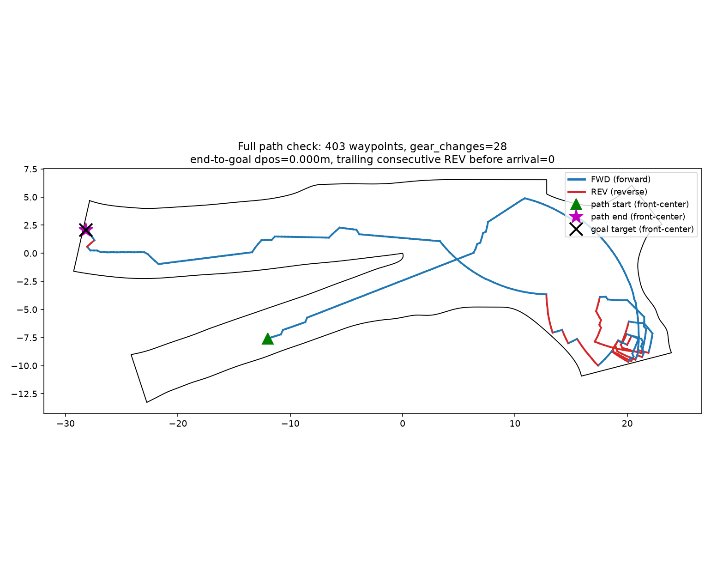
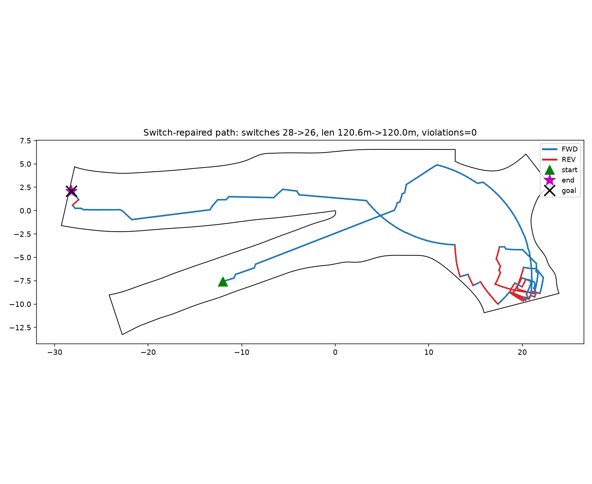
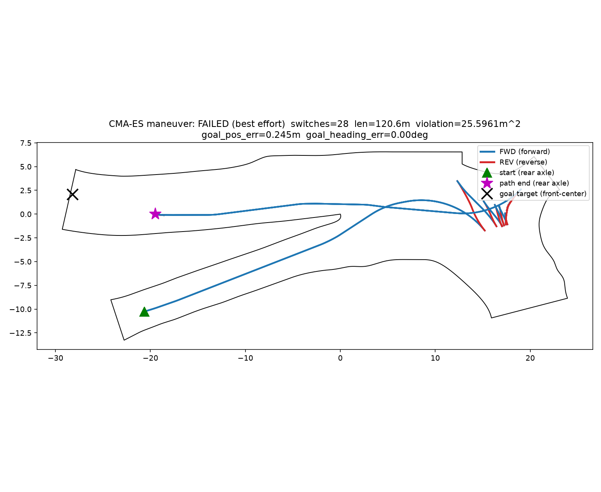
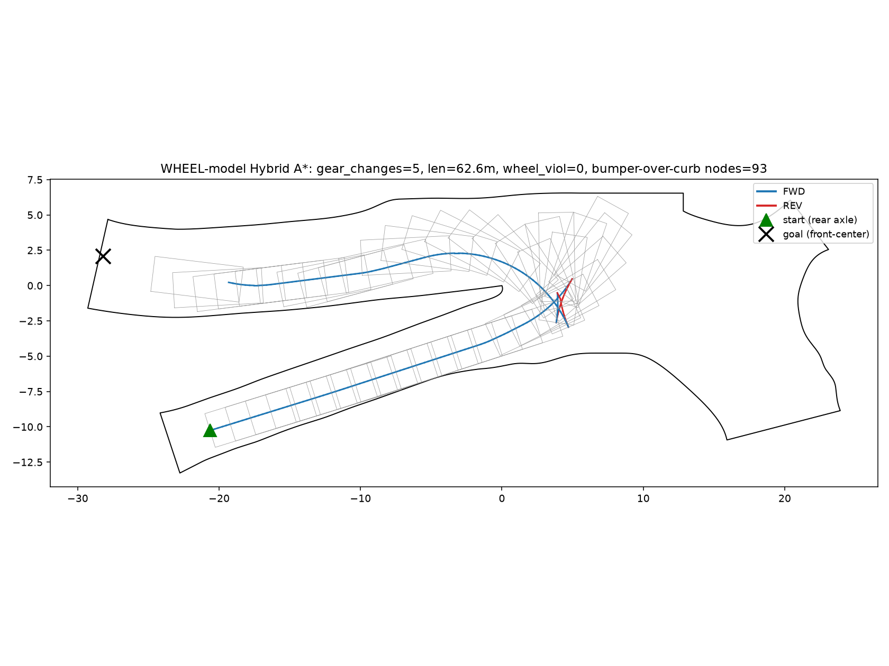
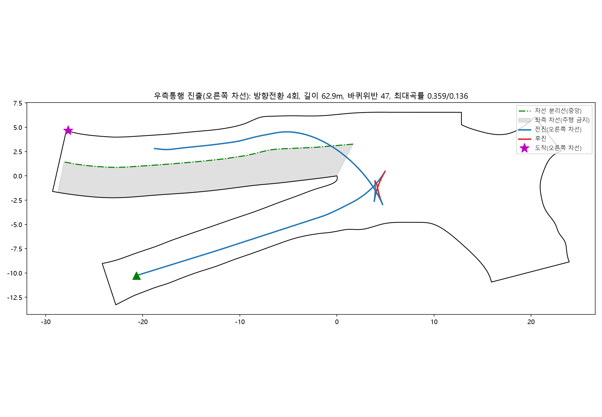

# 셔틀버스 회차 경로 최적화 — 설계 보고서

> 대상: ∧자 분기점 셔틀버스 회차(아래 경사로 진입 → 회차 → 윗 경사로 진출)
> 산출물 경로: `simulation/geometry/reference_path_keepright.json` (우측통행 최종본)

---

## 1. 기존 상세 설계 내 계획

상세 설계 단계의 계획은 **강화학습(PPO) 기반 정책 학습**으로 회차 경로를 얻는 것이었다. 파이프라인은 다음과 같이 설계되었다.

**(1) 기하 파이프라인**
- CAD 도면(`road_model.dxf`, mm)에서 평면 경계·종단 경사를 추출(`geometry/dxf_parser.py`, `build_geometry.py`) → 노면 경계 폴리곤(`road_boundary.json`)과 경사 맵(`grade_field.py`) 생성.

**(2) 차량 운동학 모델**
- 뒷축 중심 기준 **kinematic bicycle model**(`kinematics/bicycle.py`). 공표 최소회전반경 R_min(바깥 앞바퀴 자국 기준)과 앞 윤거로 뒷축 중심 회전반경 R=7.37m·조향한계 δ_max=40.5°를 재유도.

**(3) 학습 환경**
- Gymnasium 환경(`envs/bus_hairpin_env.py`): 관측(목표 상대자세, 라이다 레이, 경사, 경로 진행률), 행동(가감속·조향각속도), **보상 shaping**(경로 진행 potential, 경계 여유, 급조향·방향전환·정지체류 페널티, 목표 보너스), 시작자세 **커리큘럼**.

**(4) 학습·평가**
- PPO로 정책을 학습(`train_ppo.py`)하고, 결정론적 롤아웃으로 성공률·위반·방향전환을 평가(`evaluate.py`).

즉 원 설계는 "환경·보상을 정의하고 정책을 학습시켜 경로를 창발시키는" 접근이었다.

---

## 2. 상세 설계 이후 변경 사항

상세 설계 실행 과정에서 다음 세 가지 근본 변경이 있었다.

1. **해법 패러다임 전환: 강화학습(PPO) → 탐색·기하 기반(Hybrid A*).**
   PPO 학습이 좁은 회차 구간에서 안정적으로 수렴하지 못해(성공률 붕괴 후 미회복 등), 정책 학습 대신 **R_min을 정확히 지키는 전/후진 원호 프리미티브의 격자 탐색(Hybrid A*)** 으로 경로를 직접 계산하는 방식으로 전환했다.

2. **충돌 판정 모델 교정: 차체(범퍼) → 바퀴(타이어).**
   초기에는 차체 전체(뒷축→앞범퍼 9.06m 포함)를 경계 안에 가두었으나, 현장 제약(노면 경계에 **연석**이 있어 바퀴는 넘을 수 없지만 차체 오버행은 그 위 허공으로 넘어감)을 반영해 충돌 판정을 **바퀴 접지 기준(축거 6.29m·전폭)** 으로 바로잡았다. 이는 문제 난이도를 실제 물리에 맞게 완화한 핵심 변경이다.

3. **운영 제약 추가: 우측통행.**
   아래 경사로(진입)는 일방통행이나 **윗 경사로(진출)는 2차선 양방향**이므로, 마지막 전진 진출 구간이 오른쪽 차선을 따르도록 제약을 추가했다.

---

## 3. 현재 솔루션을 도출해낸 과정 (변천사)

경로 형상이 크게 바뀐 다섯 시점으로 정리한다. 각 시점의 **접근법**과 **알고리즘 수정**을 기록한다.

### 3-1. 1시점 — 순수 Hybrid A* (`full_path_check.png`)

- **접근법:** R_min을 정확히 지키는 전/후진 원호 프리미티브로 뒷축 (x,y,θ) 상태공간을 **양방향 격자 탐색(Hybrid A*)** 하여 경로를 직접 계산. 충돌 판정은 **차체(범퍼 포함) 전체** 기준.
- **알고리즘 구성:**
  - 상태 격자(위치·헤딩 이산화) + 고정 아크 프리미티브(steer 집합), 양방향 탐색 후 두 트리의 셀 겹침에서 접합.
  - 비용에 **후진 페널티·방향전환(gear-switch) 페널티**를 두어 전후진 조정을 억제. 도착은 "앞면이 닿는 전진 도착"만 유효(최근 N스텝 연속 전진 조건).
- **결과:** 방향전환 **28회**, 403 웨이포인트, 총 길이 120.6m, 경계 위반 0(**차체 모델 기준**). 개방 회차구역까지 크게 우회하고 벽에 붙어 잘게 전후진하는 형상.

### 3-2. 2시점 — 국소 방향전환 제거 후처리 (`reference_path_repaired.png`)

- **접근법:** 1시점의 탐색 결과에 **국소 방향전환 제거(switch-repair)** 후처리를 적용.
- **알고리즘 수정:** 접합 경로의 각 방향전환 경계를 **독립적으로** 저차원 국소 최적화(그 전환을 감싸는 두 구간의 시작/끝 자세를 고정한 채 단일 기어로 재연결 시도)로 "제거 가능한가" 검사하고, 서로 겹치지 않는 성공분만 적용.
- **결과:** 방향전환 28→**26회**, 길이 120.6m 유지, 위반 0. 국소 개선은 되나 "벽에 붙어 다수 전후진"이라는 골격은 그대로.

### 3-3. 3시점 — 진화적 최적화(CMA-ES) 처음부터 탐색 (`cma_path.png`)

- **접근법:** 격자 탐색과 전혀 다른 방법으로, 기동을 **K개 (곡률 κᵢ, 부호달린 길이 sᵢ) 구간의 열**로 표현하고 미분-프리 진화적 최적화(CMA-ES)로 처음부터 최적 기동을 탐색.
- **알고리즘 구성:** 2K차원 연속 유전자를 **닫힌형 원호 적분**으로 경로화(오일러 누적 아님), shapely 스윕 충돌 면적 + 목표 자세 오차 + 방향전환/길이 페널티를 fitness로 사용. K를 1→2→…로 늘려가며(웜스타트) 최적화.
- **결과:** **실패.** 좁은 헤어핀 포켓을 뚫지 못하고 경로의 약 70% 지점에서 반복적으로 정체. 대부분이 벽으로 막힌 좁은 통로 문제에서는 매끄러운 연속 최적화가 "진행 방향" 그라디언트 신호를 얻지 못함을 확인 → **조합적 탐색(Hybrid A*)이 이 문제에 적합**하다는 판단의 근거.

### 3-4. 4시점 — 바퀴 충돌모델로 재계획 (핵심 돌파, `hybrid_astar_wheelmodel.png`)

- **접근법:** 방법(Hybrid A*)은 유지하되, **충돌 판정 형상을 차체에서 바퀴로 교정**하고 재계획.
- **알고리즘 수정:** 충돌 footprint를 (앞=축거 L=6.29m[앞축], 뒤=0[뒷축], 반폭=전폭/2)로 교체. 범퍼(앞 오버행 2.77m)·뒷 오버행은 연석 위로 넘어가도 되므로 충돌 검사에서 제외. 탐색·접합 로직 자체는 동일. 검증도 바퀴 footprint로 수행.
- **정량적 근거:** 바퀴 기준 외측 회전반경 10.5m(차체 12.5m). 180° U턴 필요폭 ≈ 바퀴 21.0m / 차체 25.0m, 개방 회차구역 실폭 21.9m → **바퀴 모델에서만 넓은 회차가 물리적으로 성립**. 즉 이전의 다수 방향전환은 잘못된 충돌모델이 강제한 인공물이었다.
- **결과:** 방향전환 **4회**(26→4), 총 길이 **62.6m**(120.6→62.6, −48%), 바퀴 위반 0. 정점 근처에서 컴팩트하게 회차하고 매끄러운 큰 호로 진출. (범퍼가 연석을 넘는 노드 93/209개 = 구모델이 잘못 금지했던 여유.)

### 3-5. 5시점 — 우측통행 진출 재설계 (`keepright_exit.png`)

- **접근법:** 4시점의 회차 골격(마지막 후진까지)은 유지하고, **마지막 전진 진출 구간만** 2차선 양방향 윗 경사로의 오른쪽 차선을 따르도록 재설계.
- **알고리즘 구성/수정:**
  - 진출 각 지점에서 진행방향 **좌·우 벽까지 ray를 쏴 도로 폭을 측정**하고, 오른쪽 차선 중앙(좌측벽 기준 폭의 3/4 지점)을 목표 가로위치로 산출.
  - 진출 **시작점(2차 후진 직후, 헤딩 연속 고정)에서 램프 1/3 지점의 오른쪽 차선까지를 하나의 Hermite 곡선**으로 연결(차선 변경식이 아니라 처음부터 완만한 곡선으로 오른쪽 차선에 합류) → 이후 오른쪽 차선 중앙을 유지, 오른쪽 차선에 도착.
  - 급회전 포켓 구간은 곡률로 판별해 보호(옮기지 않음), 마감으로 라플라시안 스무딩. **곡률(≤1/R)·바퀴 위반**을 재검증.
- **결과:** 우측통행을 준수하는 부드러운 진출 곡선. G1~G3(도달·회전반경·포락선)은 4시점과 동등하게 유지.

---

## 4. 현재 최적 경로 성능 평가

평가 대상: 최종 우측통행 경로(`reference_path_keepright.json`).

### 4-1. 필수 통과 게이트

| 게이트 | 항목 | 판정 | 근거 |
|---|---|---|---|
| **G1** | 목표 도달 성공 | **통과** | 시작→목표를 전진으로 도착(앞면 중앙이 윗 경사로 캡, 오른쪽 차선). 접합 경로 재검증 완료. |
| **G2** | 최소 회전반경 준수 | **통과** | 전 구간 곡률 &#124;κ&#124; ≤ 1/R = 0.1357 (재계산 검증). |
| **G3** | 차량 궤적 포락선 통과 | **통과** | 바퀴 스윕 포락선이 노면 경계 내(위반 0). 차체 오버행은 연석 위 허공을 지나가므로 허용(현장 제약과 일치). |
| **G4** | AI 학습 유효성 | **해당 없음(전환)** | 최종 해법은 강화학습이 아니라 결정론적 탐색·기하 기반(상세설계 이후 RL 폐기, §2). 단, 본 경로는 향후 RL의 모방학습/커리큘럼 **기준 경로**로 활용 가능. |

### 4-2. 순위 결정 척도

| 척도 | 항목 | 현재 경로 | 비고 |
|---|---|---|---|
| **P1** | 전후진 횟수 | **4회** | 이전 26~28회 대비 대폭 감소(바퀴 모델 교정 효과). |
| **P2** | 조향 전환점 수 | 낮음 | 진출을 Hermite 곡선+스무딩으로 재설계해 곡률 부호 전환 최소. *정밀 카운트는 측정 예정.* |
| **P3** | 도로 경계 최소 여유 | 양(+) | 바퀴 위반 0이므로 전 구간 여유 양수. *최소 여유값(가장 좁은 지점)은 정밀 측정 예정.* |
| **P4** | 경로 부드러움 | 개선 | 진출 구간 Hermite+라플라시안 스무딩, 곡률 한계 내 매끄러움. |
| **P5** | 전체 길이 및 회차 시간 | 길이 ≈ 62~63m | v_max=2.0m/s 기준 순수 주행 ~31s + 전후진/정지 여유. *정밀 시간은 Vehicle Tracking으로 확정.* |

> P2·P3·P5의 정밀 수치와 회차 시간은 §5(Vehicle Tracking) 검증에서 확정한다.

---

## 5. Vehicle Tracking 시뮬레이션 결과

*(추후 작성 — Autodesk Vehicle Tracking으로 최종 경로 DXF를 주행 시뮬레이션한 스윕 경로·여유·시간 결과를 채운다.)*
